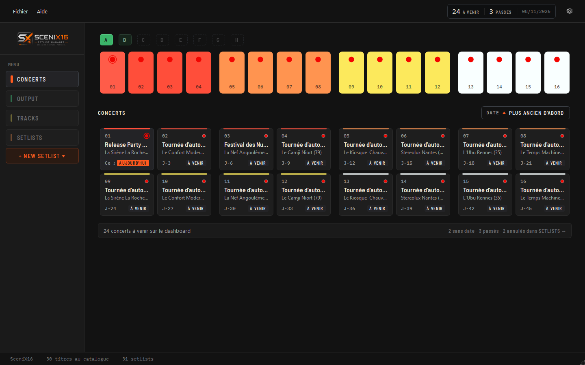
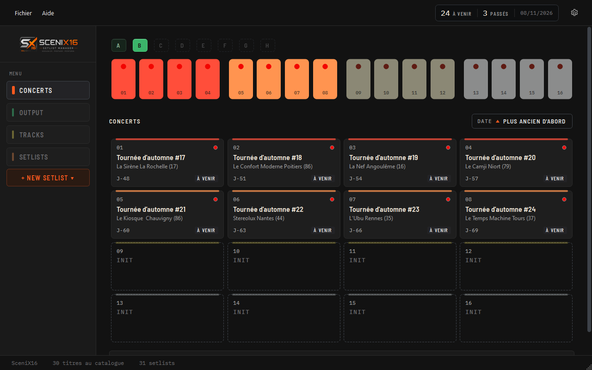
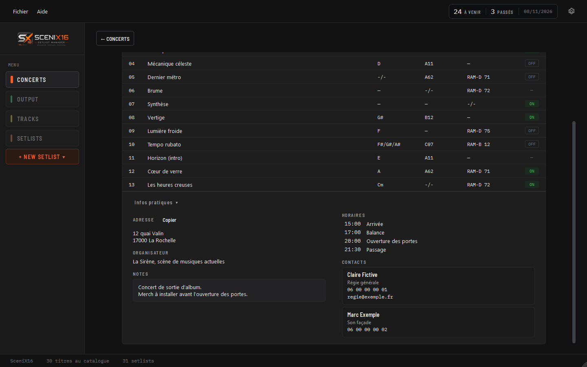
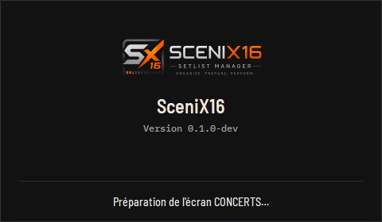

# SceniX16

Projet de développement d'une application de bureau dédiée à la gestion musicale et à la préparation de setlists pour les concerts.

L'application est conçue à partir de l'analyse du classeur Excel SceniX16 existant (`reference/SceniX16_Setlist_Manager_v2.3.0.xlsx`), qui sert de référence et n'est jamais modifié.

## Objectif

SceniX16 est une application Windows **portable**, qui fonctionne entièrement en local : pas de compte utilisateur, pas de connexion obligatoire, pas de stockage dans le cloud. Copier le dossier `SceniX16` suffit pour transférer l'application et toutes ses données sur un autre support ou un autre PC.

Elle reprend l'identité du dashboard MAIN du classeur (step sequencer inspiré de la TR-808) et permet de préparer les concerts, leurs setlists et les patchlists imprimées.

## Conception

La référence fonctionnelle et graphique en vigueur est le **Design Book v0.52** : [`docs/design-book-v0.52.html`](docs/design-book-v0.52.html). Toutes les décisions de conception (D1 à D74) et la feuille de route de la phase 2 y sont réglées ; la v0.52 consigne la clôture des phases 1 et 2. Les versions précédentes (v0.40 à v0.51) sont conservées dans `docs\` à titre d'historique et ne sont jamais modifiées.

## Technologies

| Élément | Choix |
|---|---|
| Langage | Python 3.15 (compatible 3.13 à 3.15) |
| Interface | PySide6 6.12 (module Essentials, Qt 6.12) |
| Données | SQLite (inclus dans Python) |
| Lecture du classeur | openpyxl 3.1.5, en lecture seule |
| Tests | pytest 9.2, pytest-qt 4.5 |
| Exécutable portable | PyInstaller 6.22 (mode « dossier ») |
| Polices | Barlow Semi Condensed et IBM Plex Mono, intégrées à l'application |

Les versions sont figées dans `requirements.txt` et `requirements-dev.txt`. Version affichée par l'application pendant le développement : `0.1.0-dev` (convention Q18 du Design Book ; les identifiants d'incréments comme 2.8b ne sont jamais des numéros de version). La version candidate `0.1.0-rc.1` ne sera préparée qu'après les phases suivantes (TRACKS, SETLISTS, OUTPUT) : la clôture des phases 1 et 2 ne fait pas de SceniX16 un logiciel prêt à être distribué.

## État d'avancement

| Phase | Contenu | État |
|---|---|---|
| 0 – Socle technique | Environnement, structure, fenêtre de base, exécutable portable | Terminée |
| 1 – Données | `UserData`, base SQLite, import du classeur, contrôle du démarrage | Terminée (clôture administrative en cours) |
| 2 – Dashboard | Écran CONCERTS (MAIN) en lecture seule, fiche du concert en consultation | Terminée (clôture administrative en cours) |
| 3.0, 3.1 et suivantes | TRACKS, SETLISTS, OUTPUT et impression, édition des concerts et des setlists, paramètres et visuels | À réaliser |

**Phase 1, réalisé :** création de `UserData` avec vérification des droits d'écriture ; avertissement au démarrage si `UserData` n'est pas accessible en écriture, avec copie complète du dossier portable vers un emplacement choisi ; verrou empêchant deux lancements simultanés sur le même `UserData` ; base SQLite ; import du classeur en ligne de commande et depuis PARAMÈTRES, avec rapport d'import.

**Phase 2, incréments réalisés** (feuille de route de la section 13 du Design Book) :

| Incrément | Contenu | État |
|---|---|---|
| 2.1 à 2.5 | Règles métier, polices et touches, squelette du dashboard, séquenceur et 16 emplacements, tri et mémorisation | Livrés (commités) |
| 2.6 à 2.6e | Banques de concerts, identité visuelle du dashboard, enveloppe de l'application (barre de menus, afficheur, À propos, Licences), ajustements visuels, paire sélectionnée | Validés |
| 2.7 (2.7a à 2.7c) | Fiche du concert en consultation : données, écran, navigation et retour | Validé |
| 2.8a | Bascule automatique du jour SceniX16 à 06:00, en direct (D73) | Validé |
| 2.8b | Navigation clavier : flèches sur les cartes, un arrêt de Tab par groupe, Entrée et Espace sur tous les boutons, répétition des touches (D65, D46, D9) | Validé |
| 2.8c | Animations en direct : réglage Windows « Afficher les animations » suivi pendant l'exécution, pulsation suspendue hors du dashboard | Validé |
| 2.8d | Écran de démarrage (D72), sur le même écran que CONCERTS (écran du pointeur, sinon principal), rapport d'échec anonymisé | Validé |
| 2.8e | Barre de titre : barre native sombre (option A de D61) ; prototypes de barre personnalisée abandonnés pour cette version | Validé sous Windows 10 |
| 2.9 | Corrections (filet crème et anneau de focus, tests sensibles au pointeur) et nouvelle présentation des infos pratiques de la fiche | Validé |

Les incréments 2.6 à 2.9 sont validés et publiés sur GitHub.

**Disponible aujourd'hui (depuis les sources) :**

- l'écran CONCERTS : 16 touches et 16 emplacements par banque, banques A, B…, tri mémorisé, paire sélectionnée, aperçu au survol, afficheur d'information au jour SceniX16 actualisé à 06:00 ;
- la fiche du concert en consultation (setlist complète, infos pratiques), ouverte par un clic ou au clavier ;
- la navigation entièrement au clavier (Tab, flèches, Page précédente / suivante, Entrée, Espace, Échap) ;
- la barre de menus (Fichier › Quitter, Ctrl+Q ; Aide › À propos, Licences et composants tiers) ;
- PARAMÈTRES, avec l'import du classeur dans une base vide ;
- l'écran de démarrage, la barre de titre native sombre et le respect en direct du réglage Windows des animations.

**Pas encore disponible :** l'édition des concerts et des setlists, SETLISTS, NEW SETLIST, TRACKS, OUTPUT et l'impression, les projets et les visuels, les sauvegardes, la localisation FR/EN, la barre latérale repliée (reportée : elle dépend de l'icône de l'application, Q16).

## Screenshots

Captures de la clôture des phases 1 et 2, réalisées sur des données fictives.

**Écran CONCERTS** : 16 touches et 16 emplacements de la banque A, tri par date, concert du jour sélectionné.



**Banques de concerts** : banque B sélectionnée, emplacements libres en INIT, disposition compacte (1280 × 800).



**Fiche du concert** : setlist complète et infos pratiques dépliées (adresse, organisateur, notes, horaires, contacts).



**Écran de démarrage** : version et étape réelle du démarrage.



Les 11 captures de référence sont dans [`docs/captures/phases-1-2/`](docs/captures/phases-1-2/).

## Stockage local

Toutes les données sont écrites dans le dossier `UserData`, à côté de l'exécutable (en développement : à la racine du projet). L'application ne dépend pas de `%LOCALAPPDATA%` et n'enregistre jamais de données ailleurs sans le dire.

```
UserData\
├─ scenix16.db      base SQLite (morceaux, setlists, concerts)
├─ settings.json    préférences (sens de tri), créé au premier changement
├─ .scenix16.lock   verrou d'instance (un seul SceniX16 à la fois)
├─ media\           visuels importés (prévu)
├─ backups\         sauvegardes (prévu)
└─ logs\            rapports d'import et rapports d'échec du démarrage (chemins anonymisés)
```

`UserData` est exclu de Git.

## Import du classeur

L'import lit le classeur en lecture seule et reprend les données **telles quelles**, sans aucune correction. Les particularités détectées (lieu sur deux lignes, « 0 » affichés dans des cases MK vides, patch partagé, écritures inhabituelles…) sont signalées, cellule par cellule, dans un rapport Markdown enregistré dans `UserData\logs\`.

L'import se fait uniquement dans une base vide : si `UserData\scenix16.db` contient déjà des données, il est refusé pour ne rien écraser.

Résultat sur le classeur de référence : 37 morceaux, 3 setlists, 64 entrées de setlist, 13 particularités à vérifier.

## Tests

État à la clôture des phases 1 et 2 (08/11/2026) : **764 tests réussis et 4 ignorés** sur une plateforme Qt sans affichage (`offscreen`, référence), **768 réussis** sur l'écran réel (Windows 10). Les tests ignorés hors écran exigent un vrai affichage Windows (barre de titre sombre, vrai message `WM_SETTINGCHANGE`, deux écrans).

Sur l'écran réel, quelques tests restent sensibles au pointeur de la souris ou à l'activité du poste (`test_preview_inside_window_at_200_percent`, `test_menu_items_readable_in_every_state`, `test_column_width_independent_of_scrollbar`, `test_appears_after_delay_under_the_card`) : un échec isolé ne vient pas de l'application ; éloigner le pointeur et relancer. Les tests de `tests/test_dashboard_selection.py` sont isolés du pointeur réel depuis la 2.9.

Toutes les données des tests sont créées dans des dossiers temporaires : la base réelle n'est jamais ouverte. Certains tests lisent le classeur de référence, en lecture seule, pour l'importer dans ces dossiers.

## Commandes utiles

Commandes PowerShell, à lancer depuis la racine du projet.

Installer l'environnement de développement :

```powershell
python -m venv .venv
.\.venv\Scripts\python.exe -m pip install -r requirements-dev.txt
```

Lancer les tests sans affichage (référence actuelle : 764 réussis, 4 ignorés) :

```powershell
$env:QT_QPA_PLATFORM = "offscreen"
.\.venv\Scripts\python.exe -m pytest
Remove-Item Env:QT_QPA_PLATFORM
```

Lancer les tests sur l'écran réel (éloigner le pointeur de la fenêtre de test) :

```powershell
.\.venv\Scripts\python.exe -m pytest
```

Importer le classeur de référence dans `UserData` (base vide uniquement) :

```powershell
$env:PYTHONPATH = "src"
.\.venv\Scripts\python.exe -m scenix16.importer
```

Ouvrir SceniX16 depuis les sources (utilise le `UserData` de la racine du projet) :

```powershell
$env:PYTHONPATH = "src"
.\.venv\Scripts\python.exe -m scenix16
```

Fabriquer le dossier portable `dist\SceniX16\` :

```powershell
.\tools\build.ps1
```

## Organisation du projet

```
docs\        Design Book (v0.52 en vigueur, versions précédentes conservées)
reference\   classeur Excel de référence (jamais modifié)
src\scenix16\
  ui\        interface : fenêtre principale, enveloppe (shell), dashboard,
             fiche du concert, PARAMÈTRES, écran de démarrage, écran de lancement,
             barre de titre sombre, suivi du jour et des animations, composants, thème
  domain\    règles métier du dashboard (classement, banques, jour SceniX16)
  services\  services pour l'interface (dashboard, fiche, licences, relocalisation)
  storage\   UserData, base SQLite, préférences, verrou d'instance
  startup.py, startup_report.py
             séquence de démarrage et rapport d'échec anonymisé
  importer\  import du classeur et rapport
  resources\ logo par défaut, icônes, polices, textes de licence
tests\       tests automatiques
tools\       fabrication de l'exécutable portable
```

## Prochaines étapes

1. Clôture administrative des phases 1 et 2 : commits (sur autorisation), fabrication et vérification de l'exécutable, captures.
2. Phases 3.0, 3.1 et suivantes : TRACKS, SETLISTS, OUTPUT et impression, édition des concerts et des setlists.
3. Préparation de la version candidate `0.1.0-rc.1`, seulement ensuite.

**Réserves maintenues :**

- Windows 11 n'a jamais été testé (barre de titre sombre, écran de démarrage multi-écrans, comportements de la phase 2.8) ;
- performances du démarrage : piste distincte, non traitée ;
- matrice de test de la section 08 du Design Book : seules les configurations disponibles sur le poste de développement (Full HD, deux écrans à 100 %, 1024 × 640, 200 % simulé) ont été testées ;
- essai en conditions réelles de la bascule de 06:00, notamment la nuit du changement d'heure ;
- icône de l'application (Q16) et droits et licence de SceniX16 (Q19) : questions ouvertes, préalables à toute distribution ;
- dépôt GitHub : aucun envoi tant que sa visibilité n'est pas clarifiée ; le classeur de référence, qui contient de vraies setlists, figure dans l'historique Git.

## Statut

Phases 0, 1 et 2 terminées fonctionnellement (incréments 2.1 à 2.9 validés) ; clôture administrative en cours. SceniX16 n'est pas encore un logiciel distribuable : TRACKS, SETLISTS et OUTPUT restent à réaliser.
